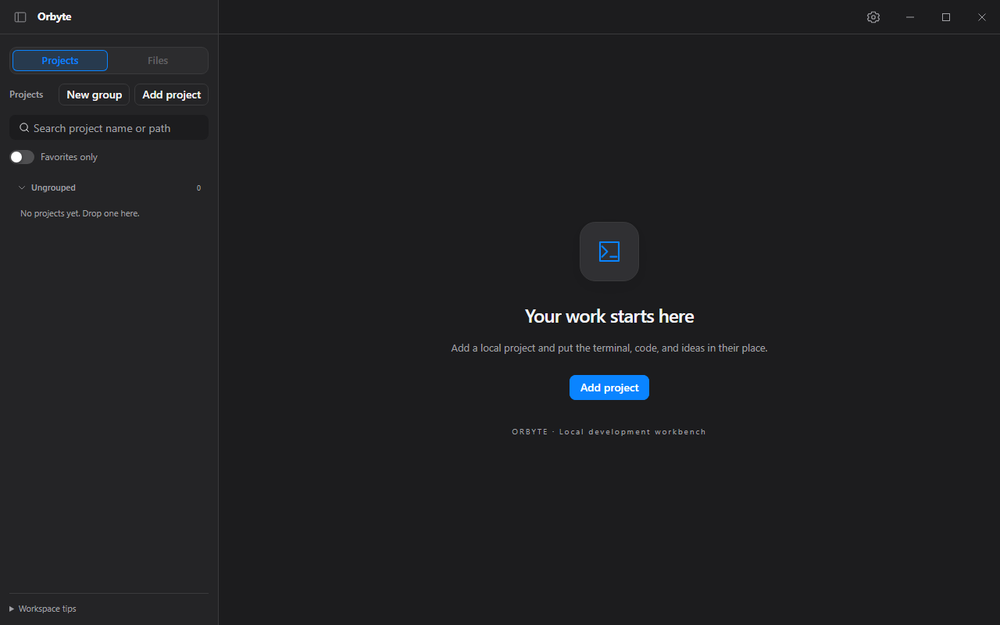

# Orbyte

[English](README.en.md) · [下载 Windows 安装包](https://github.com/jaswtao/Orbyte/releases/download/v0.1.0/Orbyte_0.1.0_x64-setup.exe) · [快速上手](doc/getting-started.md) · [发行说明](https://github.com/jaswtao/Orbyte/releases) · [参与贡献](CONTRIBUTING.md)

**将多个项目、终端和 AI 编码 CLI 集中到一个 Windows 窗口，减少来回切换。**

Orbyte 是一个开源的本地开发工作台。按项目组织终端和文件，在 Tab 与分屏之间切换，也可以启动已安装的 Codex / Claude Code。

- **多个项目，各自保留工作现场**：切换项目或 Tab 时，终端继续运行，未保存编辑会定期写入本地草稿，可在重启后选择恢复。
- **命令与文件并排查看**：在同一工作区运行 PowerShell、CMD 或已安装的 WSL，并编辑文本文件。
- **连接远程服务器**：保存 SSH 连接，打开远程终端，并通过 SFTP 浏览、上传和下载文件。
- **分开处理不同任务**：查看 Git 状态，新建分支 worktree 或将已有 worktree 加入项目组。

支持中文 / English 界面。使用 Tauri 2、Vue 3、Rust 和 CodeMirror 构建，项目自有代码采用 MIT 许可证。



## 版本与下载

首个公开预览版本 **v0.1.0 已提供下载，仅支持 Windows x64**。普通用户使用安装包即可，无需安装 Rust、Node.js 或构建工具。

1. 下载 [Orbyte_0.1.0_x64-setup.exe](https://github.com/jaswtao/Orbyte/releases/download/v0.1.0/Orbyte_0.1.0_x64-setup.exe) 和 [SHA256SUMS.txt](https://github.com/jaswtao/Orbyte/releases/download/v0.1.0/SHA256SUMS.txt)。
2. 执行下方命令，将输出与校验文件中同名安装包的 SHA-256 比较，一致后安装。
3. 打开 Orbyte，添加本地项目目录，点击「新建终端」。完整步骤见[快速上手](doc/getting-started.md)。

```powershell
Get-FileHash .\Orbyte_0.1.0_x64-setup.exe -Algorithm SHA256
```

安装包暂未签名，Windows 可能显示信任提示。Git、WSL、Codex、Claude Code 需自行安装；Orbyte 不捆绑这些 CLI。

## 开发与构建

需要 Visual Studio C++ Build Tools（含 Windows SDK）、Rust MSVC 工具链、Node.js 24.15.0、pnpm 12.8.1、Python 3.13 和 Microsoft Edge WebView2 Runtime。rust-toolchain.toml 固定 Rust 1.95.0，最低支持 Rust 1.90。

```powershell
git clone https://github.com/jaswtao/Orbyte.git
cd Orbyte
pnpm install --frozen-lockfile
pnpm dev
```

运行验证：

```powershell
cargo test --workspace --tests --locked
pnpm --filter orbyte-desktop test
pnpm --filter orbyte-desktop build
```

发布前执行依赖审计和全部验证：

```powershell
cargo install cargo-audit --version 0.22.2 --locked
$scanner = & ./scripts/install-gitleaks.ps1
pwsh scripts/release-check.ps1 -Gitleaks $scanner
```

脚本任一检查失败即返回非零码。正在运行的开发版占用构建文件时，可先退出应用，或临时设置 `$env:CARGO_TARGET_DIR = 'target/post-mvp-check'` 后执行检查。

真实 SSH 协议探针需要先启动隔离的 OpenSSH 夹具，再给发布检查加上 `-SshProbe`；没有 Docker 或未加该开关时不会运行真实服务器场景：

```powershell
pwsh scripts/ssh-probe/setup.ps1
pwsh scripts/release-check.ps1 -Gitleaks $scanner -SshProbe
```

夹具、环境变量与检查矩阵见 [SSH 协议探针](doc/ssh-probe.md)。完成后执行 `pwsh scripts/ssh-probe/setup.ps1 -Down` 停止容器。

依赖审计须在每次发布时重新执行。SQLx 的可选 RSA 锁文件项保留精确豁免；检查脚本确认其不在 Windows 实际构建树中。非 Windows 平台的锁文件警告继续显示，若进入 Windows 构建树会阻止检查。历史审计结果不代替当前审计。

安装包签名等待代码签名证书；当前未配置证书指纹或签名命令。

构建 Windows NSIS 安装包：

```powershell
pnpm build
```

构建会生成第三方声明并随安装包放入 licenses/。开发请使用 pnpm dev，以加载独立开发标识，避免与安装版共用数据。

安装包生成在 `target/release/bundle/nsis/Orbyte_0.1.0_x64-setup.exe`。本地 MVP 包尚未签名；安装时按 Windows 提示确认。NSIS 安装程序在缺少 WebView2 Runtime 时提供运行时安装。

## 使用说明

- 添加本地项目目录后，可创建一层分组、收藏和拖动排序。同一目录只能添加一次；不支持 UNC 或 WSL 网络目录。
- 选择 PowerShell、CMD 或 WSL 新建终端。PowerShell 优先使用已安装的 PowerShell 7，否则回退到 Windows PowerShell。WSL 需要已安装的发行版。
- 项目和 Tab 切换、窗口最小化时，终端继续运行，编辑器保留未保存修改和撤销历史。
- 左侧栏右缘可拖动调整宽度，宽度会记住。Tab 可双击或右键「修改名称」。`Ctrl+Tab`、`Ctrl+Shift+Tab`、`Alt+←/→` 与 `Alt+1`–`Alt+9` 在终端和编辑器聚焦时也能切换当前项目的 Tab。
- 打开文件可创建编辑器 Tab，也可与终端左右或上下分屏。再次打开同一文件会聚焦已有窗格。
- 设置中可修改主题、字体、字号、终端回滚行数、默认 Shell 和添加项目时的默认目录。外观设置应用于已打开的终端和编辑器；减小回滚行数会丢弃超出范围的终端历史。
- 设置页一次保存全部选项，任一选项保存失败时保留原设置。
- 关闭主窗口时，未保存文件可选择全部保存、不保存退出或取消。任一保存失败或冲突会取消退出，编辑内容继续保留。确认退出后并发清理终端，清理等待上限为 3 秒。
- 重启恢复项目、布局和打开的文件路径，终端在项目首次激活时重新启动。启动时自动检测未保存草稿，仅在有草稿时提示恢复，包括未访问项目和布局之外的草稿；可选择暂不恢复，之后通过「＋」菜单中的「恢复未保存草稿」重新打开列表。编辑器先读取磁盘，再提示恢复或丢弃草稿。
- PowerShell / CMD 默认启用 Shell 集成，窗格底部显示实时目录；设置中关闭「Shell 集成」后对新会话生效。自定义提示符不兼容时可关闭。WSL 首版保留普通终端行为；CMD 无命令退出码，PowerShell 的命令开始由提示符后的回车推断，多行输入可能影响计时。
- Tab 和项目行显示命令运行、失败或未读输出标记。后台长命令默认达到 30 秒后通知，阈值 0 关闭通知；同一终端 5 秒内最多一条。通知不包含命令和输出，点击通知暂不跳转，Windows 通知效果需在安装版验证。
- `+` 菜单的 AI CLI 可启动 PATH 中已安装的 Codex / Claude Code，宿主为 PowerShell；CLI 退出后留在 Shell，重新启动窗格会再次启动 CLI。
- 安装 Git 后，已激活项目在侧栏显示分支、改动数和 ahead/behind；文件树标记改动。项目首次激活、文件变化、命令结束和窗口重新聚焦时刷新，亦可手动刷新。单次查询超时 5 秒，文件超过 5000 项时截断。
- 项目右键的「Worktree…」可新建分支 worktree，或把已有 worktree 添加为同组项目。目标必须是尚不存在的本地绝对路径。删除项目只删除工作区配置，需在终端自行执行 `git worktree remove` 清理 worktree。
- 终端窗格「导出」保存当前屏幕和回滚缓冲为 UTF-8 文本，还原折行，上限 50 MiB，超限舍弃最旧内容。保存路径由原生对话框选择，取消不报错。
- 侧栏切换到「远程连接」后可保存 SSH 连接并打开远程工作区。连接支持密码或私钥认证；首次连接某个算法时核对主机、端口、算法和 SHA-256 指纹，同一端点不同算法分别保存。
- 远程工作区提供多 Tab 终端和 SFTP 文件面板。一次「连接」只索取一次密码或私钥口令，供本工作区当前待连接的终端和文件面板使用，所有尝试结束后从内存清除，不写入数据库。
- 文件面板支持刷新、进入／返回目录、新建目录，以及上传、下载文件和目录。同名目标需选择覆盖、跳过或取消；远程终端每 30 秒发送一次要求回复的保活探测，连续 3 次无应答（约 90 秒）后标记连接失效，需手动重连。
- 传输失败或取消时会尽力清理本任务的临时文件；断网导致清理失败时，界面显示残留的 `.orbyte-transfer-<UUID>.part` 精确路径。文件面板不能删除这些残留，请在远程终端中处理。

应用快捷键可通过“设置 → 快捷键设置”打开独立弹窗，按键录入、增删绑定或清除。冲突会提示并阻止保存；支持单项恢复和一键恢复全部默认，在快捷键弹窗点击保存后即时生效，重启后保留，不受主设置页保存或取消影响。以下为默认绑定。

| 快捷键 | 操作 |
| --- | --- |
| `Ctrl+Shift+T` | 新建终端 |
| `Ctrl+Shift+W` | 关闭当前窗格 |
| `Ctrl+F4` | 关闭当前页签 |
| `Ctrl+Shift+H` / `Ctrl+Shift+J` | 左右 / 上下分屏 |
| `Ctrl+Shift+PageUp` / `PageDown` | 切换 Tab |
| `Ctrl+Tab` / `Ctrl+Shift+Tab` | 下一个 / 上一个 Tab |
| `Alt+←` / `Alt+→` | 上一个 / 下一个 Tab |
| `Alt+1` … `Alt+9` | 打开第 1–9 个 Tab |
| `Ctrl+Shift+←` / `→` | 切换项目 |
| `Ctrl+Shift+Alt+←` / `→` | 侧栏变窄 / 变宽 |
| `Ctrl+Shift+F` | 项目搜索 |
| `Ctrl+P` | 按文件名打开，遵守 ignore 规则 |
| `Ctrl+Shift+P` | 快速打开，包含忽略文件 |
| `Ctrl+Shift+C` / `V` | 终端复制 / 粘贴 |
| `Ctrl+V` | 终端优先粘贴文本；截图保存为 PNG 后粘贴文件路径，供 Codex 等 CLI 识别 |
| `Ctrl+S` | 保存当前编辑器 |

## MVP 限制

- 终端 `Ctrl+V` 粘贴截图时，PNG 保存在应用缓存目录的 `clipboard-images/` 下，不会改写系统剪贴板。缓存文件保留，可在不再需要时手动清理。WSL 终端粘贴 `/mnt/<盘符>/...` 路径。无选区时右键与 `Ctrl+V` 相同；`Ctrl+Shift+V` 仅粘贴文本。
- SSH 首期支持密码和 OpenSSH Ed25519／RSA 私钥（含加密私钥），RSA 使用 SHA-2 签名。不支持 PuTTY `.ppk`、SSH agent、keyboard-interactive／MFA、证书认证和系统 `ssh_config` 导入；服务器只提供 keyboard-interactive 时连接失败并说明原因，不把口令送入交互问答。
- 主机密钥只接受 `ssh-ed25519`、`rsa-sha2-512` 和 `rsa-sha2-256`，拒绝 SHA-1 密钥交换、MAC 与 `ssh-rsa` 主机密钥。已保存算法优先协商；同一算法公钥变化时拒绝认证，不能降级到未信任密钥。
- 远程传输不跟随符号链接，跳过设备、管道和套接字；不保留属主、ACL、扩展属性或 Unix 执行位。首期不提供远程删除、权限编辑、远程文本编辑、暂停、续传或自动重试；取消目录任务不回滚此前已提交的文件。

- 编辑器支持 UTF-8（含 BOM）和 GBK，单文件上限 5 MiB。自动识别优先 UTF-8，状态栏可指定编码重新打开；不支持其他编码的可靠识别。GBK 无法表示的字符需要改为 UTF-8 保存或取消。
- 保存检测磁盘版本，冲突时由用户选择覆盖、重新加载或取消。删除文件进入系统回收站。文件树隐藏 `.git`，`Ctrl+P` 遵守 `.gitignore`、`.ignore` 和 Git exclude 等规则，`Ctrl+Shift+P` 包含被忽略的文件；两种模式均排除 `.git` 与应用临时文件，各自的索引最多包含 10 万文件。
- 文件名索引忽略普通内容修改、Git 内部和原子保存临时事件；结构变化、`.gitignore`、`.ignore` 与项目内 `.git/info/exclude` 修改会在监听批次完成后使下次搜索重建。忽略规则只影响普通打开模式，包含忽略文件的模式仍可搜索这些文件。
- 从受管理终端启动的 GUI 子程序也随终端或应用退出。若命令把请求转交给已经运行的独立 GUI 实例，该实例不受 Orbyte 管理。
- Windows 子进程由 Job Object 管理。WSL 的 Linux 后代依赖 WSL 自身的生命周期行为，无法保证所有自行脱离会话或交由 Linux 服务管理的进程退出；不执行 `wsl --shutdown`，以免影响其他 WSL 工作。
- 正式构建关闭开发者工具，并禁止 F5、Ctrl+R 和原生右键菜单刷新。系统注销、关机或强制结束仍可能丢失尚未落盘的最后一段输入。
- WebView 重载后只订阅后续终端输出，不回放此前屏幕历史，界面会提示历史丢失。
- 当前发布验收与未完成项目见 [发布检查表](doc/release-checklist.md)。仓库分层见 [项目结构](doc/project-structure.md)。

## 本地数据与隐私

安装版数据库与 Shell 集成脚本位于 `%APPDATA%\com.orbyte.desktop\`；截图缓存位于 `%LOCALAPPDATA%\com.orbyte.desktop\clipboard-images\`。开发版使用 com.orbyte.desktop.dev 标识和独立目录。窗口状态还可能保存在应用的本地配置目录。删除这些目录前先备份，不假设卸载会清除用户数据。

草稿正文保存在同一个本地 SQLite 数据库中，不上传、不写入诊断日志。输入停止 750 毫秒后写入，持续输入时最长每 5 秒刷新（另需排队及存储耗时），正文上限为 5 MiB UTF-8 字节。恢复只修改编辑缓冲区，不自动写回源文件，也不恢复撤销历史。明确放弃修改、保存成功或撤销到已知磁盘基线时清理对应草稿；取消关闭和异常退出保留最近成功落盘的副本。项目路径变更后仅支持查看、复制或丢弃旧草稿。

本分支新增草稿恢复、索引优化以及 SSH／SFTP 尚待安装版交互验收，公开 v0.1.0 下载不代表包含这些改动。SSH 协议自动探针结果见 [SSH 协议探针](doc/ssh-probe.md)，其余执行记录见[下一阶段验收](doc/next-stage-validation.md)。

应用诊断日志位于应用数据目录的 `logs/orbyte-<UTC日编号>-<分片>.log`，使用 JSON Lines 格式，包含时间戳（Unix 毫秒）、级别、进程、模块，以及启动/退出、数据库错误、终端状态、前端异常和操作结果/耗时。操作日志包含请求编号与项目/会话 ID，不记录终端正文、键盘输入、文件正文、剪贴板或设置值。日志按 UTC 日及 2 MiB 大小轮转，最多保留最近 30 天；启动、跨日写入及运行期间每小时清理过期文件，旧版 `terminal.log*` 也按修改时间清理。应用未运行时将在下次启动清理；清理失败会报告错误并重试。详情见 [终端恢复与诊断](doc/terminal-recovery.md)。

Orbyte 本身未配置遥测或应用自动更新服务。Shell 命令、Git 与第三方 AI CLI 按各自行为访问网络；WebView2 引导安装可能下载微软运行时。导出内容和截图可能包含私人信息，请勿直接提交至 Issue。

## 发布与许可证

从已提交、工作区干净的源码创建指向当前提交的标签（如 `git tag v0.1.0`），再执行 `pwsh scripts/prepare-release.ps1 -Tag v0.1.0`，可生成安装包、源码归档、MPL 对应源码及 SHA-256 清单。脚本按 Cargo 实际构建目录查找当前版本的安装包，支持 `CARGO_TARGET_DIR`。GitHub 标签发布流程须先通过完整 CI（含历史泄密扫描及最低 Rust 版本检查），只创建草稿预发布版，完成原生验收后再人工公开。

项目自有内容采用 [MIT](LICENSE)，版权声明为 **Copyright (c) 2026 jaswtao**；已有源码作者注释保留。

第三方内容仍遵循各自许可，详见 [完整声明](THIRD_PARTY_NOTICES.txt) 和 [依赖许可清单](THIRD_PARTY_LICENSES.json)。发布附件提供 third-party-mpl-sources.zip。

[贡献指南](CONTRIBUTING.md) · [问题反馈](https://github.com/jaswtao/Orbyte/issues) · [安全反馈](SECURITY.md)
