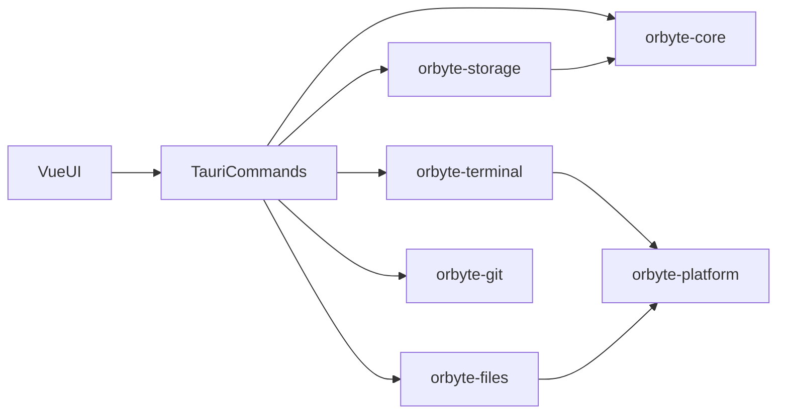

# Project structure

[中文](project-structure.md)

Orbyte is a local Windows development workbench. The interface uses Vue 3, the desktop host uses Tauri 2, and project, terminal, file, and Git capabilities live in Rust crates.

## Repository layout

```text
.
├── apps/desktop/                 Vue 3 interface and Tauri host
│   ├── src/components/           Workspace, sidebar, editor, dialogs
│   ├── src/services/             Frontend services that call Tauri commands
│   ├── src/stores/               Pinia state for projects and Git
│   ├── src/i18n/                 Chinese and English copy
│   ├── src-tauri/src/commands/   Tauri commands
│   └── tests/                    Frontend tests
├── crates/                       Rust workspace members
├── doc/                          Structure notes, release checklist, third-party licenses
├── scripts/                      Dependency audit, license generation, release checks
└── .github/workflows/            Windows CI and draft release
```

The root [`Cargo.toml`](../Cargo.toml) defines the Rust workspace. [`pnpm-workspace.yaml`](../pnpm-workspace.yaml) manages the desktop app dependencies.

## Layers

The interface does not touch the database or processes directly. Components call Tauri commands through `src/services`, and those commands enter the matching crate.



`orbyte-storage` uses the project and settings types from `orbyte-core`. Terminal and file access go through `orbyte-platform` for Windows processes, shells, and paths.

## Rust crates

- `orbyte-core`: project, group, settings, shortcut, and layout rules.
- `orbyte-storage`: SQLite persistence. Changes that touch multiple tables run in a transaction.
- `orbyte-terminal`: PTY sessions, output flow control, and subscriptions.
- `orbyte-files`: file index, watching, read/write, and path checks.
- `orbyte-git`: invokes the system Git binary and parses porcelain output.
- `orbyte-platform`: Windows Job Objects, shell discovery, and process launch.

## Desktop interface

`apps/desktop` uses Vue 3, Vite, Pinia, Naive UI, xterm.js, and CodeMirror.

- `src/components/workspace`: workspace and split panes.
- `src/components/sidebar`: project sidebar and context menu.
- `src/components/editor` and `src/components/files`: editor, file tree, and quick open.
- `src/components/dialogs`: project, group, worktree, and close confirmation.
- `src/services`: terminal, editor, files, Git, workspace layout, and appearance. Each `*Api.ts` module is the boundary that calls Tauri.
- `src/stores/projects.ts` and `src/stores/git.ts`: active project and Git state.

## Tauri commands

Commands live in `apps/desktop/src-tauri/src/commands`. Errors are converted into text the interface can show.

- `project`: projects, groups, and settings.
- `workspace`: open layout and activity.
- `files`: file tree, read/write, and quick open.
- `terminal`: create, write, read, and close terminals.
- `git`: branch status and worktrees.
- `clipboard`: terminal clipboard and screenshot paths.
- `export`: export the terminal scrollback.

The host entry point is `src-tauri/src/lib.rs`. It owns the window lifecycle, close confirmation, and the global Job.

## Related documents

- [Usage](../README.en.md)
- [Release checklist](release-checklist.md)
- [Contributing](../CONTRIBUTING.md)
