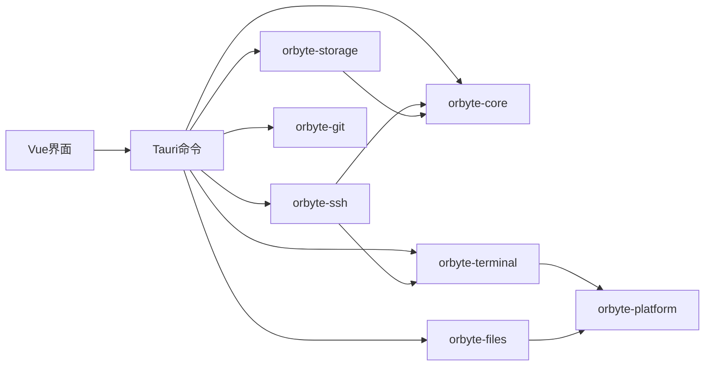

# 项目结构

[English](project-structure.en.md)

Orbyte 是 Windows 本地开发工作台。界面用 Vue 3，桌面宿主用 Tauri 2，项目、终端、文件和 Git 能力放在 Rust crate 中。

## 仓库目录

```text
.
├── apps/desktop/                 Vue 3 界面与 Tauri 宿主
│   ├── src/components/           工作区、侧栏、编辑器、对话框
│   ├── src/services/             调用 Tauri 命令的前端服务
│   ├── src/stores/               Pinia 状态（项目、Git）
│   ├── src/i18n/                 中英文文案
│   ├── src-tauri/src/commands/   Tauri 命令
│   └── tests/                    前端测试
├── crates/                       Rust 工作区成员
├── doc/                          结构说明、发布检查与第三方许可
├── scripts/                      依赖审计、许可证生成、发布检查与 SSH 探针夹具
└── .github/workflows/            Windows CI 与草稿发布
```

根目录 [`Cargo.toml`](../Cargo.toml) 定义 Rust 工作区，[`pnpm-workspace.yaml`](../pnpm-workspace.yaml) 管理桌面应用依赖。

## 分层

界面不直接访问数据库或进程。组件通过 `src/services` 调用 Tauri 命令，命令再进入对应 crate。



`orbyte-storage` 使用 `orbyte-core` 的项目与设置类型。终端和文件访问通过 `orbyte-platform` 处理 Windows 进程、Shell 与路径。`orbyte-ssh` 负责 SSH／SFTP 网络与传输，复用 `orbyte-terminal` 的输出帧和流控协议，不经过 `orbyte-platform`。

## Rust crate

- `orbyte-core`：项目、分组、设置、快捷键与布局规则。
- `orbyte-storage`：SQLite 持久化，多表修改在事务中完成。
- `orbyte-terminal`：PTY 会话、输出流控与订阅。
- `orbyte-ssh`：SSH 会话、主机密钥与算法校验、SFTP 浏览、传输队列与临时文件提交。
- `orbyte-files`：文件索引、监听、读写与路径校验。
- `orbyte-git`：调用系统 Git，并解析 porcelain 输出。
- `orbyte-platform`：Windows Job Object、Shell 探测与进程启动。

## 桌面界面

`apps/desktop` 使用 Vue 3、Vite、Pinia、Naive UI、xterm.js 和 CodeMirror。

- `src/components/workspace`：工作区与分屏窗格。
- `src/components/remote`：远程连接列表、连接表单、主机指纹确认、远程终端与 SFTP 文件面板。
- `src/components/sidebar`：项目侧栏与上下文菜单。
- `src/components/editor`、`src/components/files`：编辑器、文件树与按文件名打开。
- `src/components/dialogs`：项目、分组、worktree 与关闭确认。
- `src/services`：终端、编辑器、文件、Git、工作区布局、外观与远程连接。各 `*Api.ts` 是调用 Tauri 的边界。
- `src/stores/projects.ts`、`src/stores/git.ts`：当前项目与 Git 状态。

## Tauri 命令

命令位于 `apps/desktop/src-tauri/src/commands`，错误转成界面可展示的文本。

- `project`：项目、分组与设置。
- `workspace`：打开的布局与活动状态。
- `files`：文件树、读写与快速打开。
- `terminal`：创建、输入、输出与关闭终端。
- `remote`：SSH 连接配置、主机信任、远程工作区与终端、SFTP 浏览和传输队列。
- `git`：分支状态与 worktree。
- `clipboard`：终端剪贴板与截图路径。
- `export`：导出终端回滚缓冲。

宿主入口是 `src-tauri/src/lib.rs`，负责窗口生命周期、关闭确认和全局 Job。

## 相关文档

- [使用说明](../README.md)
- [发布检查表](release-checklist.md)
- [贡献指南](../CONTRIBUTING.md)
